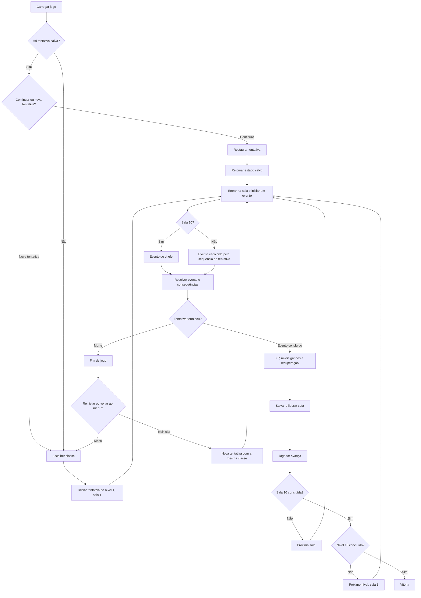

# Mapa técnico do jogo — estrutura modular v0.3

Este documento registra a estrutura acordada até agora. Valores, fórmulas e conteúdo que ainda não foram decididos devem ficar configuráveis, sem serem espalhados pela lógica do jogo.

## 1. Direção do projeto

- Jogo 2D para navegador, em tela vertical, com controles por toque e clique.
- Direção visual: fantasia sombria retrô; cenário inicial de esgoto ou calabouço.
- Exploração em primeira pessoa, com uma sala/corredor por vez.
- O jogador só avança. A seta de avanço fica disponível depois que o evento da sala termina.
- Tecnologia confirmada: Phaser com TypeScript para renderização e interface 2D no navegador.

## 2. Fluxo de telas e jornada



Regras confirmadas:

- A beta terá até 10 níveis, com 10 salas por nível; a sala 10 contém o chefe.
- Cada sala tem exatamente um evento. Ele começa automaticamente quando o jogador chega.
- A seta só é liberada quando o evento termina e o processamento pós-evento está concluído.
- O chefe do nível 10 encerra a tentativa com uma tela de vitória.
- Morrer encerra a tentativa. A tela de fim de jogo permite reiniciar com a mesma classe ou voltar ao menu.
- Não há progresso permanente entre tentativas.

## 3. Estados principais do jogo

Manter o fluxo como estados explícitos evita que uma ação de interface altere diretamente partes não relacionadas do jogo.

- `menu`: início, continuação ou nova tentativa.
- `classSelection`: escolha entre Guerreiro, Ladino e Mago; mostrar os atributos iniciais antes de confirmar.
- `roomEvent`: evento atual está ativo.
- `combatTurn`: combate ativo e entidade da vez definida.
- `eventSettlement`: evento terminou; entregar XP quando aplicável, resolver níveis ganhos e recuperação.
- `attributeAllocation`: janela modal com os atributos, botões `+` e pontos restantes; a jornada pausa até todos os pontos serem distribuídos.
- `roomReady`: evento processado; seta de avanço habilitada.
- `lootChoice`: item encontrado com inventário cheio; substituir um espaço ou descartar o item.
- `gameOver`: permite reiniciar com a mesma classe ou voltar ao menu.
- `victory`: chefe do nível 10 derrotado.

## 4. Evento de sala

O sistema da sala não deve depender de combate. Combate é um tipo de evento que usa o mesmo ciclo de vida dos demais.

```text
chegar à sala -> criar/iniciar evento -> evento ativo -> evento concluído
              -> resolver consequências -> liberar seta -> avançar
```

Cada evento deve informar ao fluxo comum quando começou, qual estado precisa salvar e quando está concluído. A condição de conclusão pertence ao tipo de evento. Assim, no futuro, um evento de combate, tesouro ou outro tipo pode terminar por regras diferentes sem mudar o avanço de sala.

Tipos iniciais definidos: combate, sala vazia, ponto de descanso e baú de tesouro. Baús podem conceder itens ou magias; combates podem conceder XP e têm uma chance de conceder item. Conteúdo e probabilidades ainda serão configurados.

## 5. Geração das salas

- Manter a estrutura fixa: 10 salas por nível e chefe na sala 10.
- Usar geração híbrida: catálogo de eventos e regras controladas; a sequência pode variar entre tentativas.
- Gerar uma sequência aleatória ponderada por andar e guardá-la na tentativa. Continuar uma tentativa nunca deve sortear novamente os eventos já definidos.
- Usar em todos os andares, por enquanto, 55% combate, 15% baú, 12% descanso e 18% sala vazia; a última sala é sempre o chefe.
- Não é necessário gerar um labirinto: a progressão é linear; o que varia é o evento atribuído a cada sala.
- A sala 10 permanece reservada para o chefe, independentemente da sequência aleatória.

### Geração de inimigos registrada no PDF

- Raridade inicial proposta: Comum 80%, Incomum 15%, Elite 5%. Comum acompanha o nível do jogador; Incomum fica +1 nível; Elite fica +2. A chance de Incomum/Elite pode aumentar perto do fim do nível.
- A classe de combate do inimigo é sorteada entre Destreza, Força e Mágico e define os pesos dos atributos. Raça, como Goblin, Esqueleto ou Slime, define principalmente aparência.
- Depois de gerar os atributos, há uma chance configurável de mutação (10% no exemplo do PDF). A mutação escolhe um atributo de classe e aplica um bônus de 30%, arredondado para cima: Força aumenta For, Destreza aumenta Dex ou Mágico aumenta Int.
- Implementaremos uma variação configurável de ±10% nos pesos antes da distribuição dos atributos.
- A mutação acontece depois de gerar/distribuir os atributos e pode ultrapassar os tetos normais.

## 6. Combate

O combate acontece sobre a sala atual, sem trocar para uma tela separada.

### Interface

- Nome, nível e vida do inimigo; inimigo ilustrado no centro.
- Sprite próprio por classe do jogador, por espécie de inimigo e para o chefe; o Mago e o Ladino não reutilizam mais a arte do Guerreiro.
- Vida e mana do jogador.
- Ações: Ataque, Magia, Defender e três espaços de itens.
- Magia abre uma lista de magias para seleção.
- Ícones visuais disponíveis para a poção de cura e a Flecha de Fogo; novos itens e magias precisam de seus próprios ícones.
- O combate mostra as quatro ações mais recentes num histórico persistido, com até dez linhas guardadas.
- Botões têm resposta visual ao toque; ataques, projéteis mágicos, defesa e queimadura têm efeitos animados.
- Com vários inimigos, o jogador poderá escolher o alvo.

### Turnos e ações

- A primeira versão alterna jogador e inimigo. Cada entidade terá seu próprio turno quando houver vários inimigos.
- Começar com um inimigo por combate, mas representar inimigos como uma coleção para suportar vários depois.
- Velocidade não muda a ordem na primeira versão; depois poderá influenciar a ordem dos turnos.
- O jogador pode usar qualquer quantidade de itens válidos antes de escolher a ação principal.
- Usar item não encerra o turno. Ataque, Magia ou Defender encerra o turno e passa a vez.
- Defender consome o turno do jogador e prepara a defesa para o próximo turno do oponente: multiplica por 2 a redução física ou por 1,5 a mágica. O efeito expira ao fim desse turno, mesmo se o inimigo errar ou não causar dano.
- O evento de combate termina quando seus inimigos forem derrotados. O fluxo comum da sala então processa a conclusão.

## 7. Atributos e progressão

Usar um modelo comum de atributos para jogador e inimigos. As regras desta seção foram consolidadas nesta conversa e substituem as fórmulas anteriores do PDF.

| Atributo atual | Nome no PDF | Efeito acordado |
| --- | --- | --- |
| Atributo | Efeito |
| --- | --- |
| For / FOR | Dano físico mínimo e máximo |
| Dex / DEX | Velocidade, esquiva e crítico |
| Int / INT | Dano mágico mínimo e máximo, mana máxima |
| Vit / VIT | Vida máxima |
| Res / RES | Redução de dano mágico e resistência a efeitos |
| Con / CON | Redução de dano físico e eficiência da defesa |

### Distribuição inicial por classe

Todo atributo começa com 1 ponto. No nível 1, distribuir automaticamente mais 4: `ceil(4 × 70%) = 3` vão para o atributo principal; o ponto restante é sorteado entre os atributos secundários usando os pesos da classe registrados abaixo. O teto não bloqueia essa criação inicial. A variação de pesos de ±10% aplica-se aos inimigos.

| Atributo | Guerreiro / FOR | Ladino / DEX | Mago / INT |
| --- | ---: | ---: | ---: |
| For / STR | 50% | 21,05% | 5% |
| Dex / DEX | 15% | 47,37% | 15% |
| Int / INT | 5% | 10,53% | 60% |
| Vit / VIT | 10% | 10,53% | 5% |
| Con / DEF | 10% | 5,26% | 5% |
| Res / RES | 10% | 5,26% | 10% |

### Pontos de atributo e limites

- Ao subir de nível, a entidade recebe até 2 pontos para distribuir. No nível 10, isso resulta em 28 pontos totais de atributo contando os 6 pontos-base e os 4 pontos iniciais de classe; esse orçamento permite no máximo dois atributos em 10 ou mais.
- Tetos: atributo principal pode chegar a `Nível + 1`; os demais, a `Nível`.
- A criação inicial pode ultrapassar o teto. Tetos limitam pontos distribuídos depois, não removem pontos já existentes.
- Os pontos concedidos ficam limitados ao espaço disponível até os tetos do nível atual. Pontos sem espaço disponível não são concedidos.
- Se vários níveis forem ganhos no mesmo evento, somar os pontos pedidos por nível e limitar o total ao espaço disponível no nível final.
- XP necessária para sair do nível atual: `Nível + 1`. Assim, do nível 1 para o 2 são necessários 2 XP; ao passar de nível, o XP excedente permanece para a próxima progressão.
- Recompensa de XP por inimigo: Comum 1, Incomum 2, Elite 3. Somar as recompensas e entregar o total ao fim do combate.
- Se o XP concedido gerar vários níveis, acumular os pontos numa única janela.

### Fórmulas de status

| Estatística | Fórmula |
| --- | --- |
| HP máximo | `30 + (Vit × 4) + (Nível × 3)` |
| MP máximo | `15 + (Int × 3) + (Nível × 2)` |
| Dano físico mínimo / máximo | `For × 1,2 + Nível × 0,3` / `For × 2 + Nível × 0,5` |
| Dano mágico mínimo / máximo | `Int × 1,2 + Nível × 0,3` / `Int × 2,2 + Nível × 0,6` |
| Velocidade | `10 + Dex × 1,5 + Nível` |
| Esquiva | `Min(50, 10 + (Dex − 1) × 2 + (Nível − 1) × 1,5)%` |
| Crítico | `Min(30, 5 + (Dex − 1) × 2,5)%` |
| Redução física | `Min(40, 10 + (Con − 1) × 2 + (Nível − 1))%` |
| Redução mágica | `Min(40, 10 + (Res − 1) × 2 + (Nível − 1))%` |

No nível 1 com o atributo relevante em 1, crítico começa em 5% e as reduções começam em 10%. Um crítico multiplica o dano original por 1,5 antes da redução do alvo.

Ataques básicos: Guerreiro usa o dano físico; Mago usa 50% do dano mágico; Ladino usa o dano físico acrescido de `Dex × 0,25` como bônus fixo. Cada ataque verifica a esquiva e aplica a redução correspondente ao tipo de dano. Magias podem definir multiplicadores próprios sobre o dano mágico, como Bola de Fogo ou Dardos Mágicos. Ao Defender, a redução física do próximo turno inimigo é multiplicada por 2 e a redução mágica por 1,5; a redução aplicada não passa de 100%. O efeito termina após esse turno, mesmo que nenhum golpe acerte.

### Magia inicial do Mago: Flecha de Fogo

- Causa 100% do dano mágico do Mago e custa 10 MP. Pode ser esquivada e causar crítico, seguindo as regras comuns de combate.
- Tem 40% de chance de aplicar Queimadura ao alvo sobrevivente.
- Queimadura causa, no fim de cada turno do inimigo, dano elemental equivalente a 30% do dano rolado pela Flecha de Fogo antes da redução mágica do alvo; cada pulso aplica a redução mágica do alvo.
- Dura até 2 turnos. Após cada pulso, a entidade tenta resistir: chance `Min(50%, RES × 5%)`; sucesso remove a Queimadura depois de receber o dano daquele pulso.
- Reaplicar não acumula efeitos: renova a duração para 2 turnos e atualiza o dano por pulso com o novo lançamento.

### Geração de inimigos

- Raridade: Comum 80%, Incomum 15%, Elite 5%; chefes são sempre Elite.
- Classe escolhida uniformemente entre Guerreiro, Ladino e Mago. O nível é o nível atual do jogador +0/+1/+2 conforme a raridade.
- A raridade não tem multiplicador próprio de HP ou dano: a diferença de atributos/status vem do nível adicional, além das recompensas de XP e item.
- A distribuição inicial usa os pesos da classe com variação independente de ±10%. A cada nível do inimigo, tenta distribuir 2 pontos ponderados, respeitando os tetos de atributos daquele nível.
- Há 10% de chance de mutação depois da distribuição. A mutação soma ao atributo principal pelo menos 1 ponto, arredondando 30% para o inteiro mais próximo, e pode ultrapassar o teto.
- O inimigo é gerado ao entrar na sala, assim salas ainda não visitadas acompanham o nível atual do jogador. Saves antigos regeneram encontros futuros quando o nível-base do inimigo estiver desatualizado.

- XP de inimigos é concedida em uma recompensa ao final do combate. Poção de XP concede XP imediatamente e pode abrir a janela de nível antes de voltar à sala.
- Se uma recompensa gerar um ou vários níveis, somar os pontos ganhos e abrir a janela de alocação. A jornada pausa até o jogador distribuir tudo.
- A janela mostra os seis atributos, botões `+` e pontos restantes.
- Dados de classe, limites e fórmulas ficam em configuração compartilhada; cálculo de atributos derivados é comum ao jogador e aos inimigos.

## 8. Vida e mana após eventos

Depois do evento, alocar os pontos de nível antes de qualquer outra consequência pós-evento. Em seguida, recuperar 1/4 da vida máxima e 1/3 da mana máxima, sem ultrapassar os máximos; salvar o evento concluído e então liberar a seta.

## 9. Inventário e itens

- Três espaços; cada espaço contém um único item, sem empilhamento.
- Inicialmente, os itens são consumíveis. Usar um remove o item.
- Se o inventário estiver cheio, o jogador escolhe um espaço para substituir ou descarta o item encontrado.
- Cada item declara em que contexto pode ser usado: combate ou fora de combate.
- Itens de combate só podem ser usados durante combate. Poções de XP são usadas fora de combate.
- Itens vêm de baús; ao fim de um combate também há chance de receber um item. Magias vêm de baús.
- Chance de receber item ao final do combate: Comum 10%, Incomum 50%, Elite 100%.
- Inicialmente, a poção de cura recupera 50% do HP máximo, sem ultrapassar o máximo. Poção de cura é item de combate e o uso não encerra turno.
- O segundo tipo de item inicial ainda precisa ser confirmado; poção de XP foi citada como exemplo de item utilizável fora de combate, mas seu valor ainda não foi definido.
- Os itens restantes são mantidos ao avançar de sala ou nível na mesma tentativa.

## 10. Salvamento local

- Um único espaço de salvamento no navegador; sem conta ou login. Validar a estrutura carregada e ignorar/remover dados inválidos.
- Ao carregar com save existente, oferecer continuar ou começar nova tentativa. Nova tentativa substitui o save existente.
- Salvar no início de cada turno do jogador, depois da ação do jogador antes da resposta inimiga e ao concluir o evento da sala. Ao retomar com a resposta inimiga pendente, resolvê-la antes de devolver o controle.
- Persistir classe, atributos, recursos atuais, XP, pontos pendentes, inventário, nível do calabouço, sala atual, estado do evento e sequência gerada.
- Versionar o formato do save para permitir mudanças futuras na estrutura.
- A tela de fim de jogo oferece reiniciar com a mesma classe ou voltar ao menu.

## 11. Separação de módulos implementada

```text
src/
  game/
    application/        coordenação da tentativa, salas e progressão
    combat/             resolução de ações, turnos e habilidades de combate
    content/            definições de classes, inimigos, eventos, itens e magias
    rules/              fórmulas e regras puras de atributos, XP, itens e magia
    state/              tipos, validação e criação do estado da tentativa
  infrastructure/
    persistence/        adaptador para o armazenamento local do navegador
  presentation/
    phaser/             carregamento de assets, componentes e telas Phaser
      screens/          menu, sala, combate, nível, loot e fim da tentativa
  scenes/                composição Phaser e encaminhamento de eventos da interface
  assets/                imagens do jogo
```

Responsabilidades atuais:

- `game/application/GameController.ts` coordena o estado da tentativa, ações do usuário, progressão, transições e chamadas de persistência. Retorna transições para a camada visual.
- `game/application/RunService.ts` implementa entrada e saída de sala, eventos, recompensas, alocação e avanço do calabouço.
- `game/content/*` concentra definições de conteúdo consumidas pelas regras e pelas telas, como classes, pools de inimigos, itens, magias e pesos de eventos.
- `game/combat/CombatSystem.ts` resolve ações e turnos sem depender de Phaser ou da interface.
- `game/rules/*` contém fórmulas e regras de domínio por assunto.
- `game/state/save.ts` valida os dados carregados; `game/application/RunRepository.ts` define a porta de persistência; `infrastructure/persistence/LocalRunRepository.ts` implementa o acesso a `localStorage`.
- `presentation/phaser/screens/*` desenha cada tela e encaminha interações por callbacks, sem decidir fórmulas de jogo.
- `presentation/phaser/SceneUi.ts` contém elementos visuais reutilizáveis; `GameAssets.ts` centraliza o carregamento de imagens.
- `scenes/GameScene.ts` conecta ações da interface ao controlador, aplica transições e agenda o atraso visual entre turnos.

As dependências apontam para dentro: regras e sistemas de jogo não importam Phaser; infraestrutura não define regras; telas recebem estado e callbacks; a cena compõe essas partes.

## 12. Próximos passos de arquitetura

- Separar dados de conteúdo (classes, habilidades, inimigos, itens e eventos) das fórmulas para adicionar conteúdo sem alterar o controlador.
- Adicionar migrações versionadas de save quando o formato persistido mudar.
- Quando houver mais tipos de eventos, criar um handler por evento usando o ciclo comum de sala.
- Adicionar testes de domínio para combate, progressão, inventário e salvamento antes de ampliar a complexidade.
## 13. Próximas etapas do projeto

1. Separar conteúdo de jogo (classes, inimigos, habilidades, itens e eventos) das regras e da interface.
2. Definir migrações para saves quando o formato mudar.
3. Criar testes de domínio para combate, progressão, inventário e recuperação do save.
4. Fazer partidas de balanceamento nas três classes e ajustar a progressão por andar.
5. Ampliar inimigos, baús, habilidades, chefes e variação visual entre andares.

## 14. Decisões ainda abertas

- Como Res reduz efeitos de estado; a redução de dano mágico já está definida.
- Multiplicadores de dano e custo de mana das demais magias.
- Como a velocidade altera a iniciativa e a ordem dos turnos.
- Segundo item inicial, itens dos baús e catálogo de magias.
- Ajuste das chances de raridade de inimigos nas salas mais avançadas do nível.
